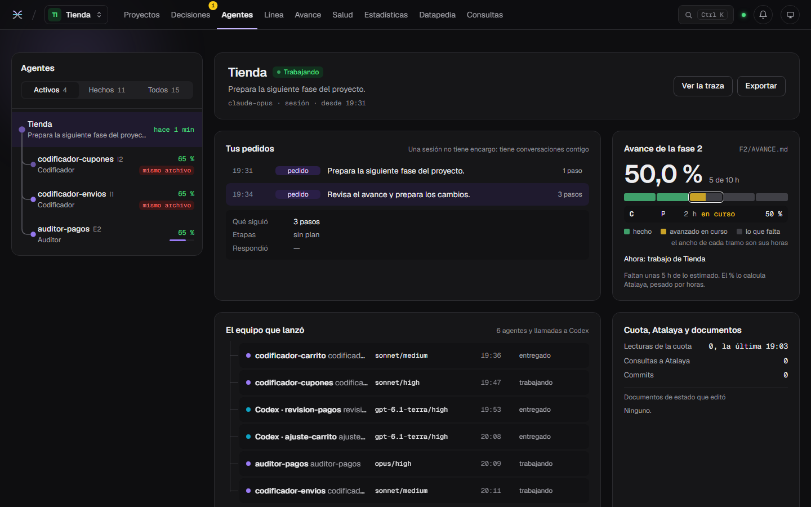
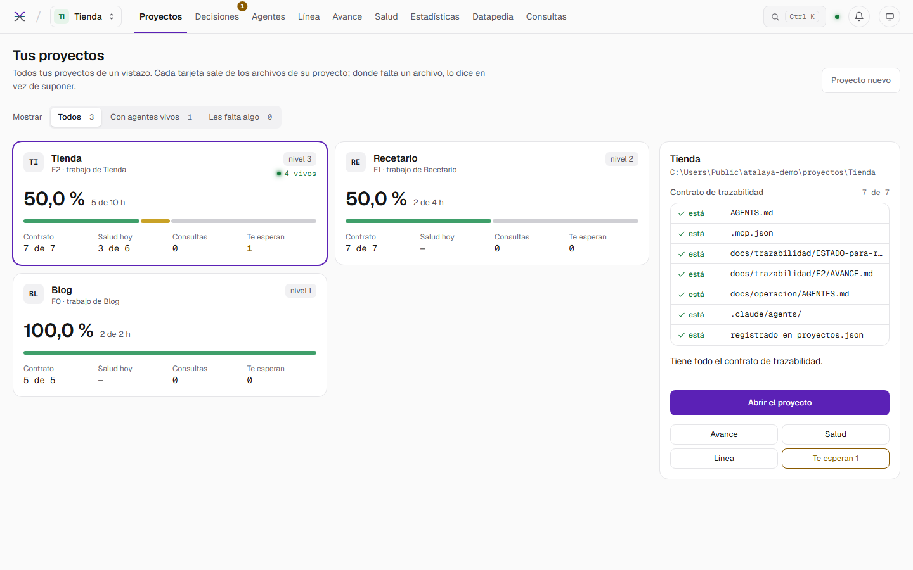
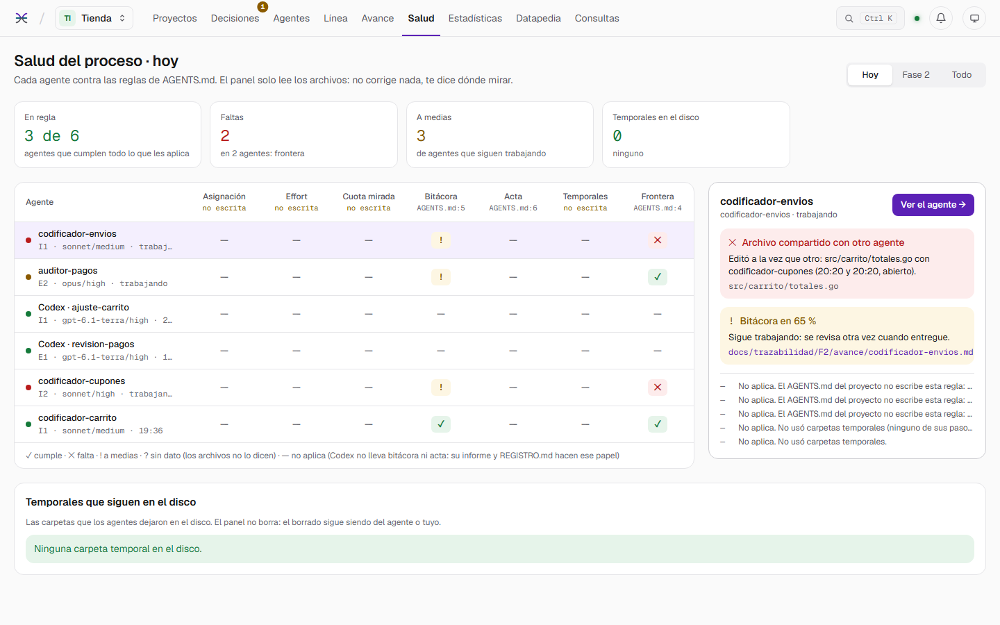
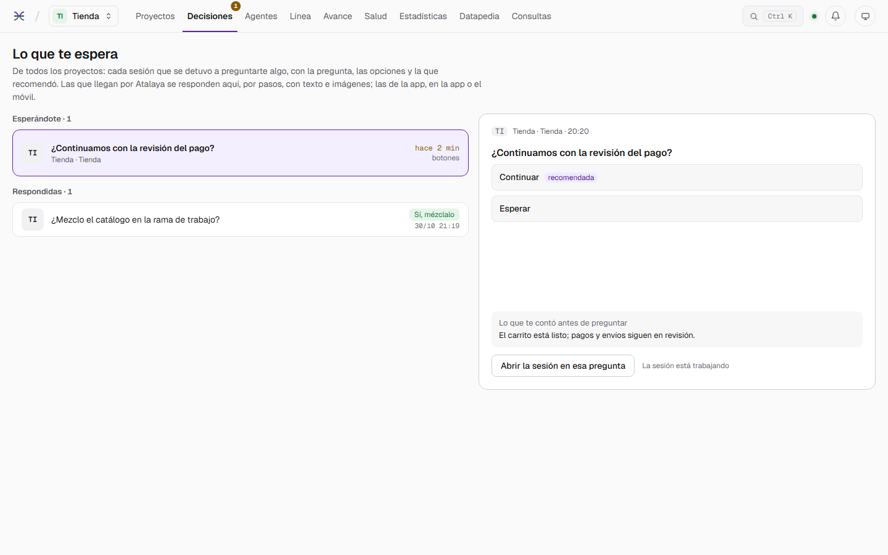
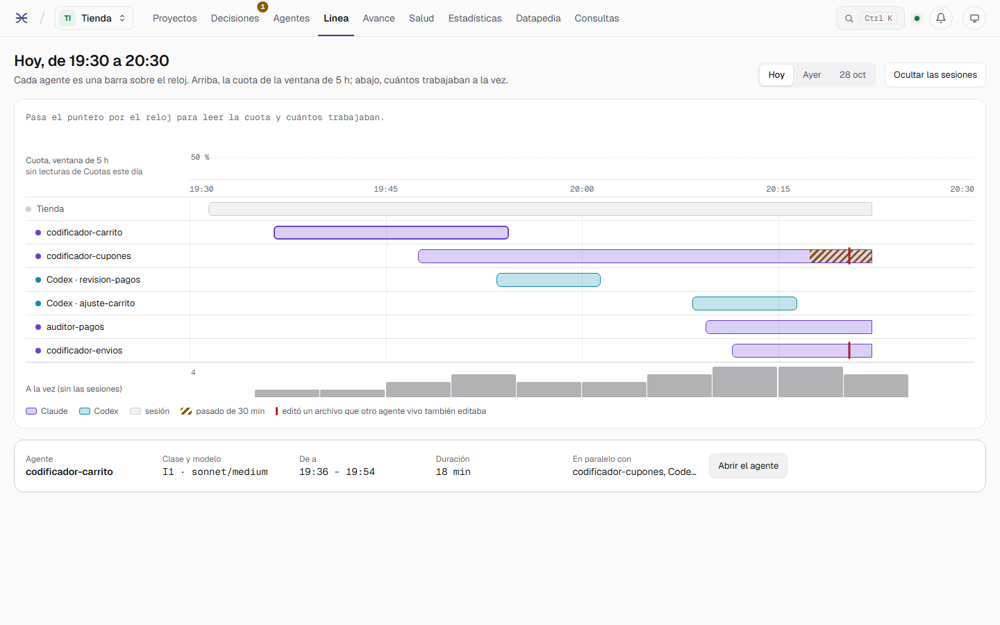
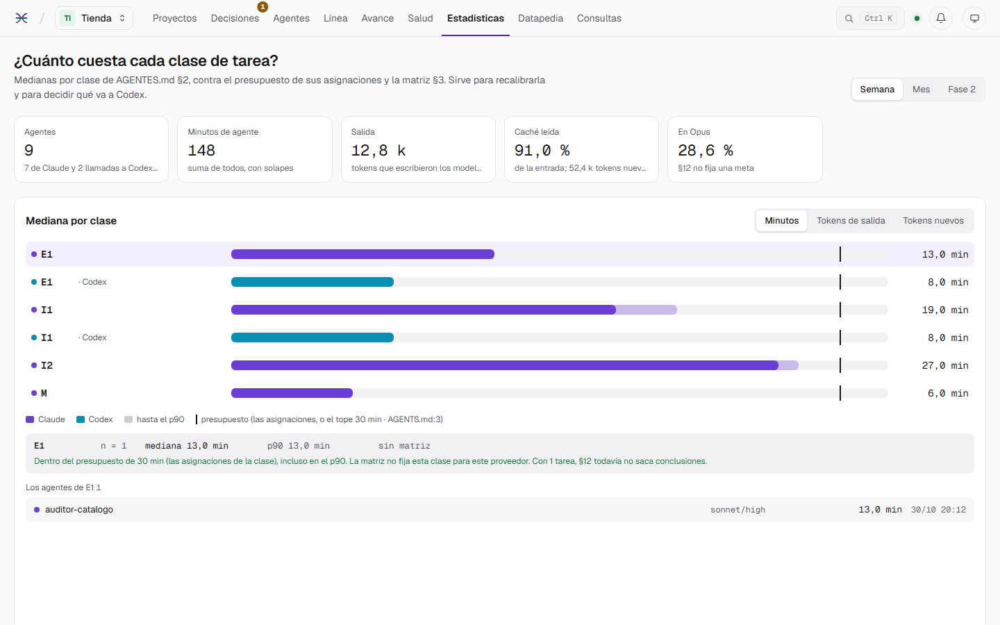
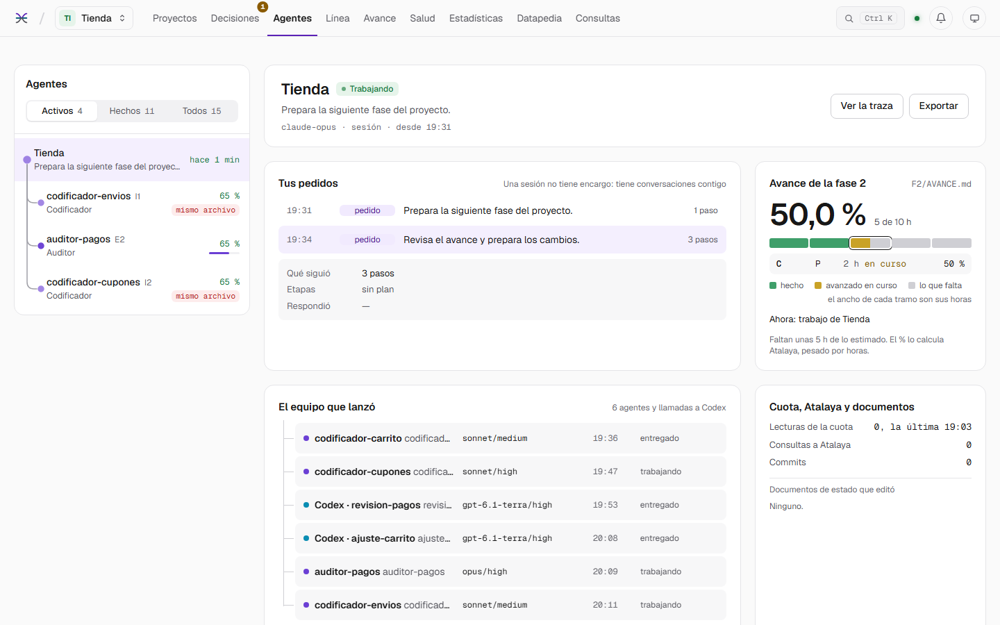

# Atalaya

**Una torre de vigía local para tus agentes de IA de programación.** Atalaya sigue en vivo lo que hacen Claude Code y
Codex en todos tus proyectos, revisa cada agente contra las reglas que escribiste, te avisa cuando algo te espera y les
responde a los propios agentes por MCP. Solo lee, escucha solo en `127.0.0.1` y no necesita ninguna cuenta.

[English](README.md) · **Español** · [Instalar](docs/INSTALAR.md) · [Novedades](CHANGELOG.md) · Licencia MIT



---

## Para qué sirve

Cuando varios agentes trabajan a la vez (una sesión principal, sus subagentes, llamadas a Codex) es fácil perder de
vista quién está haciendo qué, si alguno se pasó de su tiempo, si dos tocan el mismo archivo o si una sesión lleva rato
esperando tu respuesta. Atalaya lo junta todo en un panel local y lo convierte en datos que los agentes también pueden
consultar.

## Qué hace

| | |
| --- | --- |
| **Agentes en vivo** | Cada sesión y subagente de Claude Code y cada llamada a Codex, paso a paso: la orden, la salida, el diff de cada edición, los tokens y el contexto. Un árbol que dice quién lanzó a quién. |
| **Salud del proceso** | Revisa cada agente contra las reglas que escribiste en el `AGENTS.md` del proyecto (tope de minutos, frontera de archivos, asignación, effort, bitácora, temporales) y cita la línea de la que sale cada umbral. |
| **Avisos** | Notificaciones de Windows cuando una decisión te espera, un agente pasa su tope o dos agentes vivos editan el mismo archivo. Un clic abre el panel en su lugar. |
| **Decisiones** | La bandeja de lo que tus sesiones te preguntan. Con la herramienta MCP `preguntar`, un agente te hace preguntas de varios pasos que respondes en el panel, con texto e imágenes. |
| **Avance por fase** | Lee `docs/trazabilidad/F<n>/AVANCE.md` y calcula el % pesando cada paquete por sus horas; avisa si la cifra escrita no coincide. |
| **Línea de tiempo y estadísticas** | Los agentes de cada día sobre el reloj; minutos y tokens por clase y modelo, contra tu matriz; un resumen por semana. |
| **Diario** | Un archivo por día que conserva lo que Claude Code y Codex borran con el tiempo. |
| **Datapedia** | Búsqueda de texto completo en los documentos de tus proyectos y en los turnos de los agentes. |
| **Servidor MCP** | `que_hizo`, `buscar`, `archivo`, `salud`, `estado`, `retomar` y `preguntar`: los agentes preguntan en vez de releer documentos y transcritos. Medido: la mitad de tokens nuevos para la misma pregunta, y más aciertos. |
| **Consultas** | Lo que ahorró cada consulta MCP: los documentos que reemplazó su respuesta y los tokens que no entraron al contexto del agente, por herramienta, proyecto, rol y día, y las lecturas que una consulta habría evitado. |
| **Cuota del plan** | El uso de 5 horas y semanal de Claude, leído con `claude -p /usage` y, con un mod opcional de Claude Code ([`mods/atalaya-cuota`](mods/atalaya-cuota/README.md)), empujado en el momento en que se mueve, con su historia. |
| **Skill `atalaya-proyecto`** | Prepara un proyecto (nuevo o existente) para trabajar con agentes: instala un kit por niveles (1 indexable, 2 con agentes, 3 completo) en español o en inglés, abre su fase 0 y lo registra en Atalaya, sin pisar nada de lo que ya tenía. |

## Capturas

Sacadas de la demo (`atalaya.exe -demo`): los proyectos, los agentes y las decisiones son inventados.

| | |
| --- | --- |
|  |  |
|  |  |
|  |  |

## Estado

**Versión 1.4.0, estable.** Probado y validado en **Windows 11** con **Claude Code** (la CLI y la app de escritorio) y
**Codex CLI**. En **Linux** el panel funciona (probado en Ubuntu con WSL 2) y pasan todas las pruebas en CI,
sin notificaciones y sin `scripts/codex.ps1`, que necesita Windows; macOS compila, sin probar. La
interfaz está en español y en inglés (el botón ES/EN de la cabecera), y el kit también.

## Empezar

```powershell
git clone <la dirección de este repositorio> atalaya
cd atalaya
.\scripts\compilar.ps1          # pide Go 1.27+ y Node.js 20+; deja atalaya.exe
.\atalaya.exe                   # y abre http://127.0.0.1:7420
```

Para mirarlo antes, sin Claude Code ni Codex: `.\atalaya.exe -demo` sirve proyectos, agentes, alertas y decisiones
inventados (el mismo mundo de las capturas).

La guía completa, con el registro de proyectos, la conexión por MCP con Claude Code y Codex, la skill y las opciones,
está en **[docs/INSTALAR.md](docs/INSTALAR.md)**.

## Privacidad

- Escucha solo en `127.0.0.1`; nada sale del equipo.
- Lee los transcritos de Claude Code (`~/.claude/projects`), las trazas de Codex que escribe `scripts/codex.ps1` y los
  documentos de los proyectos que registras. Nunca lee credenciales ni tokens de acceso.
- Antes de mostrar o devolver un texto, tapa lo que parece un secreto.
- Escribe solo en su carpeta de datos (`%LOCALAPPDATA%\Atalaya`), en tus respuestas a sus preguntas y en la
  configuración de los avisos.

## Cómo está hecho

Un solo ejecutable: un servidor Go (biblioteca estándar y `modernc.org/sqlite`, sin cgo) con el panel embebido, hecho en
Next.js, React y Tailwind. Para desarrollar: `go run ./cmd/atalaya` en `backend/` y `npm run dev` en `frontend/`; para
verificar todo, `.\scripts\compilar.ps1 -Verificar`.

## Licencia

MIT. Ver [LICENSE](LICENSE).
