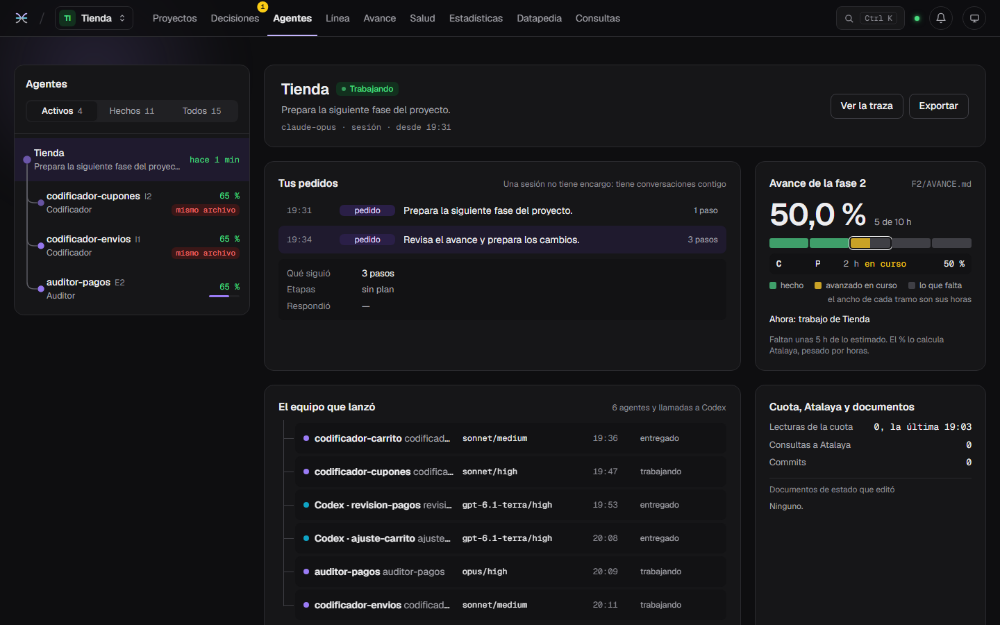
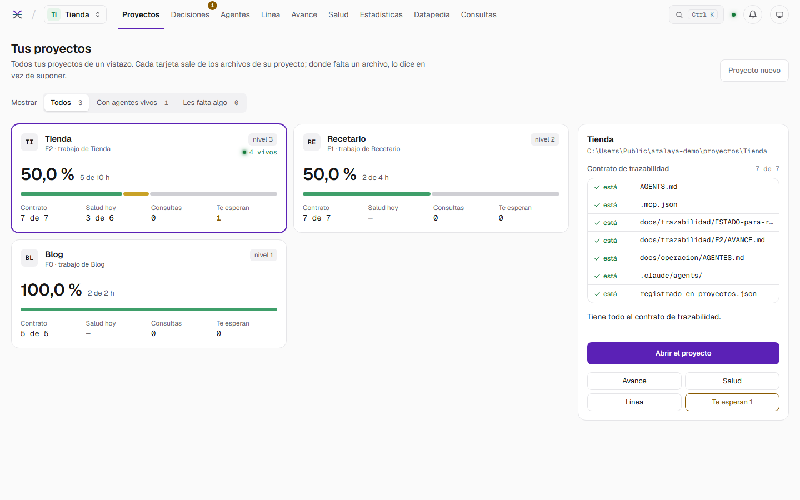
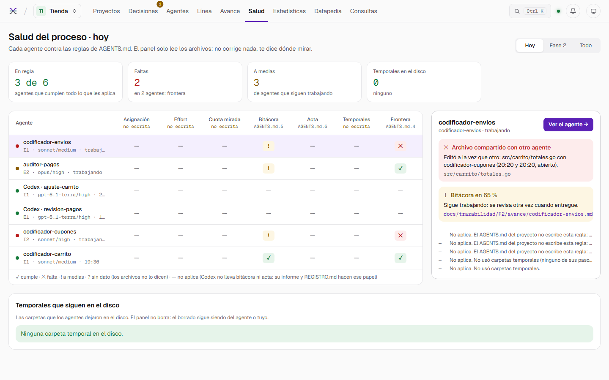
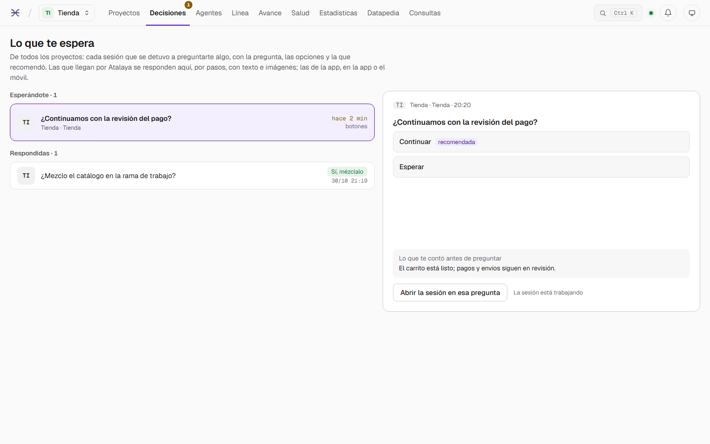
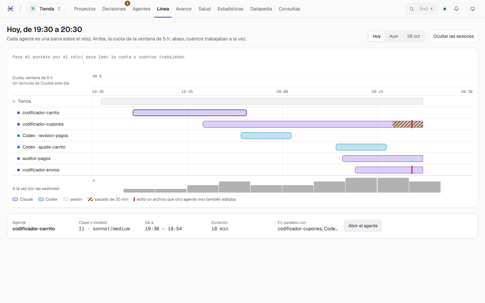
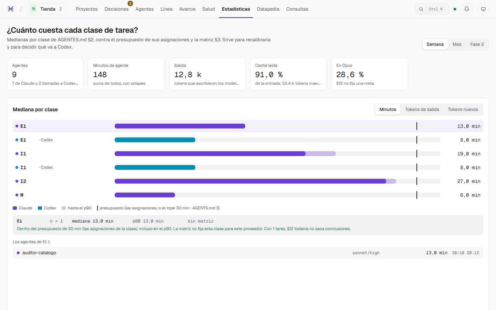
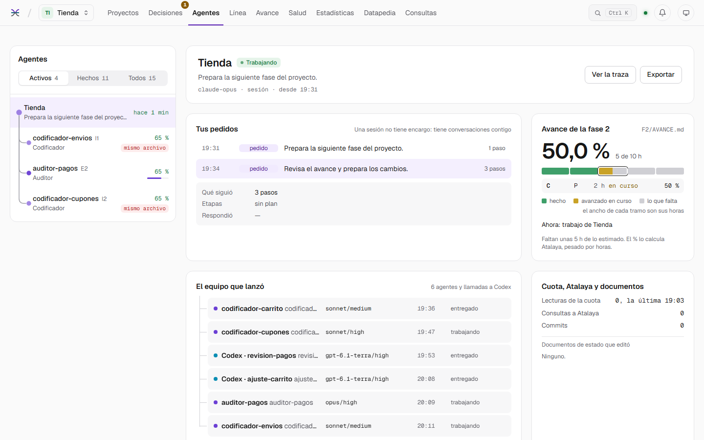

# Atalaya

**A local watchtower for your AI coding agents.** Atalaya follows what Claude Code and Codex are doing across all your
projects, live; checks every agent against the rules you wrote; tells you when something is waiting for you; and
answers the agents themselves over MCP. It only reads, listens only on `127.0.0.1`, and needs no account.

**English** · [Español](README.es.md) · [Install](docs/INSTALL.md) · [Changelog](CHANGELOG.md) · MIT license

> The panel is in English and Spanish (the ES/EN button in the header); the project kit is in Spanish. This README and the
> install guide are in both languages.



---

## Why

When several agents work at once (a main session, its subagents, Codex runs) it is easy to lose track of who is doing
what, whether one went over its time, whether two are touching the same file, or whether a session has been waiting for
your answer for a while. Atalaya puts all of it in one local panel and turns it into data the agents can query too.

## What it does

| | |
| --- | --- |
| **Live agents** | Every Claude Code session and subagent and every Codex run, step by step: the command, its output, the diff of each edit, tokens and context. A tree shows who launched whom. |
| **Process health** | Checks each agent against the rules written in the project's `AGENTS.md` (time cap, file boundaries, assignment, effort, logbook, temporary folders) and cites the line each threshold comes from. |
| **Notifications** | Windows notifications when a decision is waiting for you, an agent goes over its cap, or two live agents edit the same file. One click opens the panel in the right place. |
| **Decisions** | An inbox of what your sessions ask you. With the `preguntar` MCP tool, an agent can ask you multi-step questions that you answer in the panel, with text and images. |
| **Phase progress** | Reads `docs/trazabilidad/F<n>/AVANCE.md` and computes the % weighting each work package by its hours; warns when the written figure does not match. |
| **Timeline and statistics** | Each day's agents on the clock; minutes and tokens per task class and model, against your matrix; a weekly summary. |
| **Diary** | One file per day that keeps what Claude Code and Codex delete over time. |
| **Datapedia** | Full-text search over your projects' documents and the agents' turns. |
| **MCP server** | `que_hizo`, `buscar`, `archivo`, `salud`, `estado`, `retomar` and `preguntar`: agents ask instead of rereading documents and transcripts. Measured: half the new tokens for the same question, and more correct answers. |
| **Queries** | What each MCP query saved: the documents its answer replaced and the tokens that never entered the agent's context, by tool, project, role and day, plus the reads a query could have replaced. |
| **Plan quota** | Claude's 5-hour and weekly usage, read with `claude -p /usage` and, with an optional Claude Code mod ([`mods/atalaya-cuota`](mods/atalaya-cuota/README.md)), pushed the moment it moves, with its history. |
| **`atalaya-proyecto` skill** | Prepares a project (new or existing) to work with agents: installs a tiered kit (1 indexable, 2 with agents, 3 complete) in English or Spanish, opens its phase 0 and registers it in Atalaya, without overwriting anything the project already had. |

## Screenshots

Taken from the demo (`atalaya.exe -demo`): the projects, agents and decisions are made up.

| | |
| --- | --- |
|  |  |
|  |  |
|  |  |

## Status

**Version 1.3.0, stable.** Tested and validated on **Windows 11** with **Claude Code** (CLI and desktop app) and
**Codex CLI**. On **Linux** the panel runs (tried on Ubuntu under WSL 2) and every test passes in CI, without
notifications and without `scripts/codex.ps1`, which needs Windows; macOS compiles but is untested. The UI and the kit
are in English and Spanish.

## Quick start

```powershell
git clone <this repository's URL> atalaya
cd atalaya
.\scripts\compilar.ps1          # needs Go 1.27+ and Node.js 20+; produces atalaya.exe
.\atalaya.exe                   # then open http://127.0.0.1:7420
```

To look around first, without Claude Code or Codex: `.\atalaya.exe -demo` serves made-up projects, agents, alerts and
decisions (the same world as the screenshots).

The full guide (registering projects, connecting Claude Code and Codex over MCP, the skill and every option) is in
**[docs/INSTALL.md](docs/INSTALL.md)**.

## Privacy

- Listens only on `127.0.0.1`; nothing leaves your machine.
- Reads Claude Code transcripts (`~/.claude/projects`), the Codex traces written by `scripts/codex.ps1`, and the
  documents of the projects you register. It never reads credentials or access tokens.
- Masks anything that looks like a secret before showing or returning text.
- Writes only to its data folder (`%LOCALAPPDATA%\Atalaya`), your answers to its questions, and the notification
  settings.

## How it is built

A single executable: a Go server (standard library and `modernc.org/sqlite`, no cgo) with the panel embedded, built with
Next.js, React and Tailwind. To develop: `go run ./cmd/atalaya` in `backend/` and `npm run dev` in `frontend/`; to
check everything, `.\scripts\compilar.ps1 -Verificar`.

## License

MIT. See [LICENSE](LICENSE).
